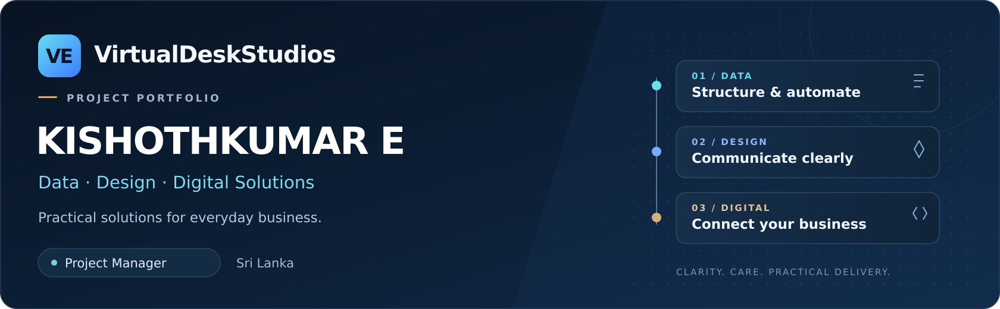

  

  <a href="https://www.virtualdeskstudios.workers.dev/projects" target="_blank" rel="noopener noreferrer"><strong>View project case studies</strong></a>
  &nbsp; · &nbsp; <a href="https://github.com/users/kishothE/projects/2/views/1">Project board</a>
  &nbsp; · &nbsp; <a href="https://www.virtualdeskstudios.workers.dev/">VirtualDeskStudios</a>
  &nbsp; · &nbsp; <a href="mailto:virtualdeskstudios@gmail.com">Discuss a project</a>
  &nbsp; · &nbsp; <a href="https://www.linkedin.com/in/kishothkumaresvaran">LinkedIn</a>

## Hello, I'm Kishoth.

**Project Manager at VirtualDeskStudios · Sri Lanka**

I help small businesses organise their data, simplify everyday work and build a clear online presence. My work brings together spreadsheet automation, graphic design, project coordination and AI-assisted website development.

I turn business needs into a clear scope, practical deliverables and an organised review process—with careful handling of business information throughout.

## Professional experience

| Organisation | Role & focus |
|---|---|
| **VirtualDeskStudios** | **Project Manager** — project scope, requirements, coordination and delivery review across data, design and digital solutions. |
| **ENK Technologies Private Limited** | **Customer Service & Technical Support · November 2023–Present** — customer enquiries and follow-ups, technical issue coordination, POS/CRM record handling, sales reporting and purchase order processing. |

## Current focus

| In Progress | Planned |
|---|---|
| **<a href="https://www.virtualdeskstudios.workers.dev/projects#novira-lifestyle-trends" target="_blank" rel="noopener noreferrer">Novira Lifestyle & Trends</a>** E-commerce development, shopping experience refinement and functional QA. Final handover and verification of the latest production changes remain pending. | **VE-HUB — Products · Services · Technology** A new division of VirtualDeskStudios. My focus is project scope, requirements and customer journeys for a planned products and services platform. Implementation and launch are not yet confirmed. A public website page is pending. [View planning summary](https://github.com/users/kishothE/projects/2/views/1?pane=issue&itemId=275151271). |

## What I can help with

| Area | Practical support |
|---|---|
| **Data & automation** | Excel and Google Sheets workflows, data cleaning, lookup tools and recurring reports. |
| **Design & branding** | Logos, promotional banners and social media visuals with a consistent identity. |
| **Websites & e-commerce** | AI-assisted business websites, responsive storefronts, online catalogues and ordering journeys. |
| **Project & business support** | Requirements, project coordination, web research, catalogue updates, documentation and functional review. |

<strong>Tools & working approach</strong>

 

<kbd>Microsoft Excel</kbd> &nbsp; <kbd>Google Sheets</kbd> &nbsp; <kbd>GitHub</kbd> &nbsp; <kbd>Google Antigravity</kbd>

I use AI-assisted tools to support delivery, then review the output against the agreed requirements. My approach combines structured data, clear documentation, responsive design and practical testing.

## Selected completed work

Open a project name to view its public website or the corresponding case study on VirtualDeskStudios.

| Project | Deliverable | Status |
|---|---|---|
| **<a href="https://www.virtualdeskstudios.workers.dev/" target="_blank" rel="noopener noreferrer">VirtualDeskStudios</a>** | Corporate website and services showcase. | Completed |
| **<a href="https://www.virtualdeskstudios.workers.dev/projects#galaxy-toy-store" target="_blank" rel="noopener noreferrer">Galaxy Toy Store</a>** | E-commerce website with product browsing and WhatsApp ordering. | Completed |
| **<a href="https://www.virtualdeskstudios.workers.dev/projects#allirani-traders" target="_blank" rel="noopener noreferrer">ALLIRANI TRADERS</a>** | Spreadsheet-based data management and reporting workflow. | Completed |
| **<a href="https://www.virtualdeskstudios.workers.dev/projects#address-lookup-system" target="_blank" rel="noopener noreferrer">Google Sheets Data Automation</a>** | Structured data management and address lookup. | Completed |
| **<a href="https://www.virtualdeskstudios.workers.dev/projects#attendance-system" target="_blank" rel="noopener noreferrer">Staff Attendance Automation</a>** | Attendance capture, working-hours calculations and reporting. | Completed solution |

*“Completed solution” refers to the attendance deliverable; a specific customer deployment is not claimed.*

## How I work

1. **Understand the need** — clarify the current process and the intended outcome.
2. **Define and deliver** — agree the scope, organise the work and review progress.
3. **Check and hand over** — test the agreed deliverables and explain how to use them.

## Let's discuss your project

Need a clearer spreadsheet workflow, a business website or design support? Share your requirements, current tools and preferred timeline.

**[Email VirtualDeskStudios](mailto:virtualdeskstudios@gmail.com)** · **[Visit our website](https://www.virtualdeskstudios.workers.dev/)** · **[Company LinkedIn](https://www.linkedin.com/company/virtualdeskstudios/)**

---

This portfolio shares project summaries. Client source code, private systems and business records remain confidential.
